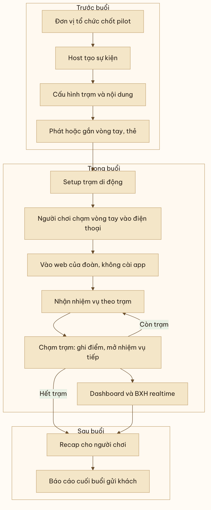
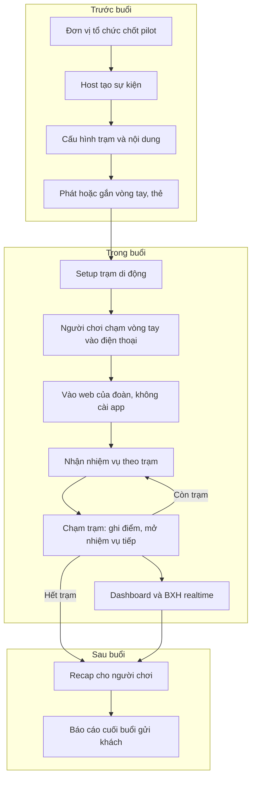

# Flow MVP B2B: core NFC cho đoàn

> Đề xuất ngày 10/11/2026, chưa phải bản duyệt cuối. Bản public: đã bỏ mọi con số giá và chi phí (chưa kiểm chứng).

## B.1. Người dùng đích và mục tiêu

- **Người mua / đơn vị tổ chức:** ưu tiên đại lý tour và MICE; thứ hai là agency sự kiện; sau mới tới HR / trường học (hướng chọn 21–23/10/2026).
- **Người chơi:** thành viên đoàn (tour, team building, sự kiện, nhóm trường).
- **Host:** ở MVP, Howl vận hành hộ (mô hình **Stage 1 Managed** — ý tưởng 23/10). Đơn vị tổ chức chưa tự tạo phòng.
- **Mục tiêu:** có 2–3 buổi với đoàn thật, trạm **di động** do Howl mang theo, thu số liệu + lời chứng thực có tên (và được phép quay tư liệu). Đây là hồ sơ để bán, không phải bản viral khách lẻ.

## B.2. Flow end-to-end

Chia ba giai đoạn. Phía host giữ **đủ nhỏ cho MVP**: Howl thao tác trên một trang quản trị nội bộ, chưa làm self-serve cho khách (đó là Stage 2: tự tạo phòng + mã PIN — **ngoài MVP**).

**Trước buổi**

1. **Chốt pilot** với đơn vị tổ chức (đổi trải nghiệm miễn phí hoặc giá pilot lấy quyền quay, số liệu và lời chứng thực có tên — đề xuất 25/10).
2. **Host tạo sự kiện:** tên, ngày giờ, số người dự kiến, chế độ cá nhân hoặc theo đội.
3. **Cấu hình trạm và nội dung:** số trạm, thứ tự hoặc điều kiện mở, nhiệm vụ / câu hỏi / ảnh tại từng trạm. Tái sử dụng quest engine; nội dung có thể lấy bộ TCV hoặc soạn bộ riêng cho itinerary của đoàn. Mục tiêu vận hành đã nêu: setup một quest mới **≤ 1 giờ**.
4. **Phát hoặc gắn vòng tay / thẻ:** map UID (hoặc mã in) với người chơi hoặc với đội. Chưa bắt đăng ký tài khoản. QR trên vòng / thẻ là lối dự phòng nếu NFC lỗi.

**Trong buổi**

5. **Setup trạm di động** tại điểm diễn ra (khu vui chơi, lộ trình tour, sân trường, venue sự kiện). Không lắp cố định. Mục tiêu đã nêu: lắp trạm **≤ 30 phút**.
6. Người chơi **chạm điện thoại vào vòng tay / thẻ** → mở **trang web của đoàn**, không cài app.
7. **Nhận nhiệm vụ** theo trạm (hoặc theo khung giờ — ý tưởng 23/10).
8. **Chạm trạm:** ghi điểm, mở nhiệm vụ tiếp, cập nhật tiến độ.
9. **Host / MC** theo dõi **dashboard live** (số người đã vào, trạm nào đang tắc, tỷ lệ hoàn thành) và **bảng xếp hạng** cá nhân hoặc theo đội, chiếu được nếu cần.

**Sau buổi**

10. Người chơi nhận **recap** cuối vòng (tái sử dụng tư duy Wrapped: thành tích, đội, số trạm; độ dài và hình thức chưa chốt cho B2B).
11. Host xuất **báo cáo gửi khách:** số tap, tỷ lệ hoàn thành, thời gian, chỗ bỏ cuộc, BXH — file xuất được (không cần portal tự phục vụ trong MVP).
12. Howl thu góp ý của người tổ chức (ngưỡng đã nêu: ≥ 8/10) và xin lời chứng thực có tên / logo nếu họ đồng ý.

## B.3. Danh sách màn hình (đề xuất, giữ nhỏ)

**Người chơi (web / PWA)**

| Màn | Vai trò |
|---|---|
| Vào sự kiện / gắn vòng tay | Mở từ NFC hoặc QR, vào đúng đoàn |
| Nhiệm vụ — trạm | Nội dung trạm, chạm để ghi nhận |
| Tiến độ của tôi / của đội | Số trạm, điểm |
| Bảng xếp hạng | Cá nhân hoặc đội, cập nhật gần realtime |
| Recap cuối vòng | Thành tích để chụp / chia sẻ |

**Host (trang nội bộ, Howl dùng)**

| Màn | Vai trò |
|---|---|
| Tạo sự kiện | Ngày, sĩ số, chế độ cá nhân / đội |
| Cấu hình trạm và nội dung | Quest, thứ tự, điều kiện |
| Phát / liên kết vòng tay hoặc thẻ | Gắn UID với người hoặc đội |
| Dashboard live | Số người vào, tap, điểm nghẽn |
| Bảng xếp hạng | Để MC / trưởng đoàn theo dõi |
| Báo cáo cuối buổi | Xem và xuất cho khách |

Không làm CMS white-label đầy đủ, không làm app native, không làm cổng thanh toán trong MVP.

## B.4. Phạm vi MVP

**Trong phạm vi**
- Core NFC dùng lại: tag → trạm, quest engine, định danh bằng UID vòng tay hoặc phiên, chạy trên web.
- Trạm di động; Howl vận hành (Stage 1 Managed).
- Trang host nội bộ: tạo sự kiện, cấu hình trạm, gắn vòng tay/thẻ, dashboard, BXH / chế độ đội, xuất báo cáo + recap.
- QR dự phòng. Thử NFC trên 5–10 máy thật trước buổi đầu.
- 2–3 buổi pilot với đoàn thật (đề xuất 25/10). Ý tưởng cũ: một buổi ~25 người với BCH quen.

**Ngoài phạm vi**
- Stage 2 self-serve (khách tự tạo phòng + PIN, tự chạy không cần Howl tại chỗ).
- White-label đầy đủ (logo/màu tối giản nếu khách cần thì cân nhắc, không phải portal thương hiệu).
- App native, blockchain / NFT, quảng cáo, thanh toán, AI guide (đã loại khỏi core 25/10).
- Gắn trạm cố định tại TCV hoặc điểm đến khác khi chưa có chủ nhà đồng ý.
- RAG (cả khách lẫn team) trong bản B2B MVP.
- Bán vòng tay như sản phẩm lẻ (chưa chốt).

## B.6. Chỉ số thành công cho pilot B2B

Lấy nguyên KPI vận hành và trải nghiệm từ đánh giá 25/10; phần thương mại 8 tuần chỉ áp dụng nếu team chọn hướng này và chạy đủ vòng, **không phải điều kiện bắt buộc trước buổi pilot đầu**:

- Tỷ lệ hoàn thành đoàn **≥ 70%**.
- Lỗi chạm **< 5%**.
- Setup quest mới **≤ 1 giờ**; lắp trạm **≤ 30 phút**.
- Điểm hài lòng người tổ chức **≥ 8/10**; hướng tới **≥ 2 lời chứng thực có tên và logo** sau các buổi pilot.
- Điều kiện dừng sản phẩm (25/10): sau 2 pilot mà hoàn thành < 50% hoặc lỗi chạm > 10% → sửa sản phẩm trước khi đi bán.
- KPI thương mại sau 8 tuần (chỉ để nhớ, chưa phải mục tiêu buổi demo flow): ≥ 10 cuộc nói chuyện với agency/MICE, ≥ 3 lời mời báo giá, ≥ 1 đơn trả tiền hoặc LOI. Mức giá trong nguồn đó chưa chốt.

## B.8. Sơ đồ flow B2B

