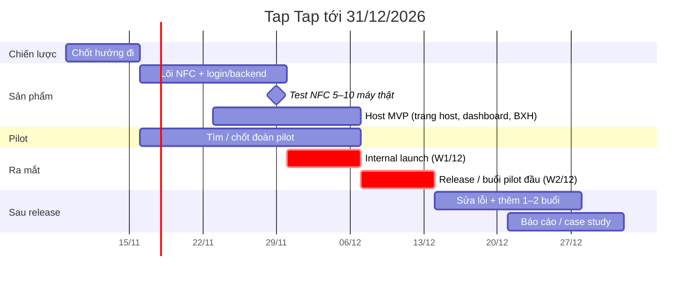

# Timeline Tap Tap tới 31/12/2026 (hướng B: pilot B2B)

> Cập nhật 11/11/2026. Đã thống nhất: **W1 tháng 12 (30/11–6/12) internal launch**, **W2 tháng 12 (7–13/12) release**. Bản nháp, sẽ chỉnh khi chốt hướng.

## Bảng theo tuần

| Tuần | Ngày | Việc chính |
|---|---|---|
| W2/11 | 9–15/11 | Chốt hướng đi |
| W3/11 | 16–22/11 | Lõi NFC + login/backend; bắt đầu tìm đoàn pilot |
| W4/11 | 23–29/11 | Lõi NFC xong; Host MVP; **29/11 test NFC 5–10 máy xong** |
| W1/12 | 30/11–6/12 | **Internal launch**: chạy thử nội bộ end-to-end; Host MVP sẵn sàng; **6/12 chốt đoàn pilot** |
| W2/12 | 7–13/12 | **Release**: buổi pilot đầu với đoàn thật |
| W3/12 | 14–20/12 | Sửa theo góp ý; thêm 1–2 buổi |
| W4/12 | 21–27/12 | Thêm buổi nếu có; viết báo cáo |
| Cuối | 28–31/12 | **31/12 số liệu pilot + báo cáo/case** |

## Mốc

| Ngày | Mốc | Trạng thái |
|---|---|---|
| 15/11 | Chốt hướng đi | Cần chốt |
| 29/11 | Test NFC trên 5–10 máy thật xong | Kế hoạch |
| 6/12 | Internal launch xong; Host MVP sẵn sàng; chốt đoàn pilot | Kế hoạch (đoàn: cần chốt) |
| 7–13/12 | Release / buổi pilot đầu | Kế hoạch |
| 31/12 | Số liệu pilot + báo cáo | Kế hoạch |

## Rủi ro lịch
- Kế hoạch 12 tuần đang nén còn khoảng 7 tuần với team 2 người.
- Tag NFC chưa mua và chưa có đoàn pilot là hai chỗ dễ trễ nhất.
- Cuối tháng 12 vướng lễ, đoàn khó xếp lịch.
