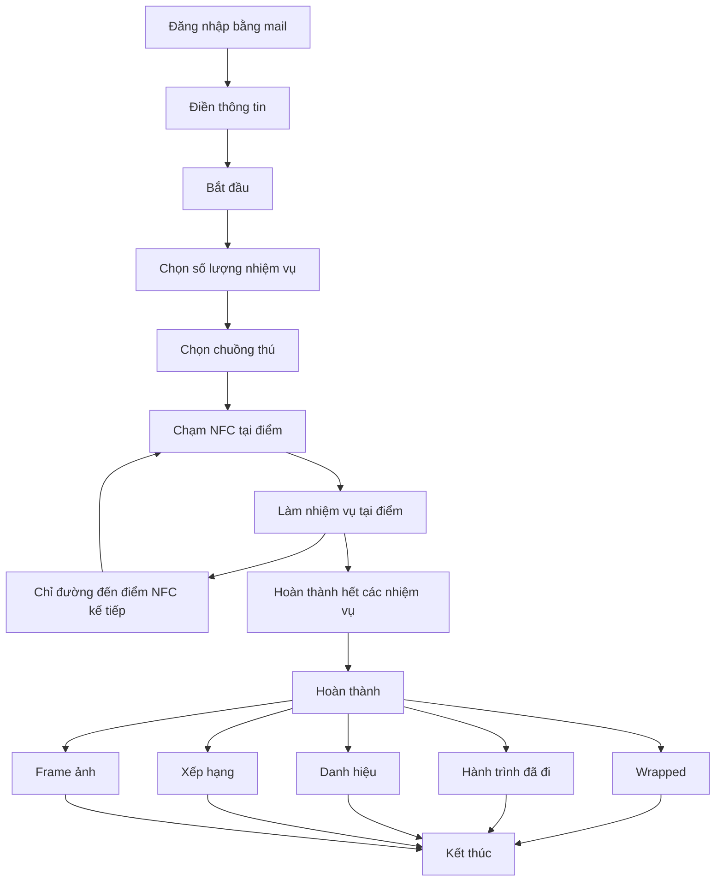

# NHI

Làm cho: Nhi (Art & Social)

## 2026-11-11
- Đã xong: Idea 2 — Choo Zoo (tổng quan, 5 nhiệm vụ core, 12 điểm break, user flow, art direction), prototype web v2, video demo v2.1, và social plan. Nội dung nằm ở các mục bên dưới; prototype ở [NHI/demo/](NHI/demo/); video ở [NHI/video/](NHI/video/).
- Đang làm: sẽ bổ sung sau
- Kế tiếp: sẽ bổ sung sau
- Vướng / rủi ro: sẽ bổ sung sau
- Cần anh BeeNgyy quyết: sẽ bổ sung sau

## Idea 2: Choo Zoo

Nguồn: file present ngày 10/11/2026, các slide about / tính năng / nhiệm vụ hệ thống / user flow / art direction của idea 2.

### Tổng quan

CHOO ZOO là website khám phá Thảo Cầm Viên thông qua công nghệ NFC. Lấy cảm hứng từ “Làm nhiệm vụ hệ thống”, người dùng quét NFC, lựa chọn nhiệm vụ và các điểm đến yêu thích trên bản đồ. Tại mỗi điểm đến, người chơi hoàn thành thử thách để tích lũy danh hiệu và ghi lại hành trình khám phá. Kết thúc chuyến đi, người dùng có thể xem lại bản đồ cùng những trải nghiệm đã thu thập.

**Map chỉ đường**
- Hiển thị điểm đang đứng
- Hiển thị chỉ dẫn đường đi chi tiết
- Hiển thị các trạm kế tiếp

**Nhiệm vụ hệ thống**
- Người chơi sẽ được chọn số lượng nhiệm vụ, có tính năng đề xuất số lượng và loại dựa trên danh hiệu và mục đích của user
- 5 core nhiệm vụ chính + các điểm break
- Di chuyển giữa các trạm tối đa 15 phút (linh hoạt)
- Có nút Pause và nút trợ giúp (tìm NVS). Deck không giải thích “NVS”.

**Wrapped**
- Tổng kết số trạm đã đi
- Xem lại hành trình
- Có danh hiệu
- Mở khóa thẻ idol bí mật
- Xếp hạng
- Nhận frame ảnh

**5 core nhiệm vụ chính**

- **Tìm con vật:** tìm con vật trong chuồng rồi chụp một tấm.
- **Đoán nhanh:** một câu hỏi vui có 3 đáp án, trả lời trong khoảng 10 giây.
- **Bắt chước:** tạo dáng giống con vật rồi chụp với frame.
- **Quan sát:** chọn con vật đang ngủ, ăn hay chơi, có cả đáp án “trốn mất rồi”.
- **Hồ sơ idol:** mở thẻ có tên, ngày sinh và một fun fact.

**12 điểm break**

1. Cổng chính
2. Tượng ếch ngồi thiền
3. Tượng hươu cao cổ
4. Ngựa vằn
5. Hà mã
6. Tường vàng
7. Nhà lan
8. Vườn xương rồng
9. Hành lang khu bọ sát
10. Vườn hồng hạc
11. Vườn bướm
12. Đền thờ vưa hùng (chữ trên slide viết vậy)

Ảnh minh họa 12 điểm trên slide không đưa vào đây.

### Flow

Thứ tự các khối trên slide user flow, đọc từ trái sang phải, trên xuống dưới:

1. Đăng nhập bằng mail → Điền thông tin → Bắt đầu → Chọn số lượng nhiệm vụ → Chọn chuồng thú
2. Chạm NFC tại điểm → Làm nhiệm vụ tại điểm → Chỉ đường đến điểm NFC kế tiếp (slide vẽ lại khối chỉ đường, vòng lặp giữa các điểm)
3. Hoàn thành hết các nhiệm vụ → Hoàn thành
4. Wrapped, Hành trình đã đi, Danh hiệu, Xếp hạng, Frame ảnh → Kết thúc

Slide có hai khối “Bắt đầu” nằm kề nhau trên hàng đầu; mermaid dưới đây gộp thành một bước vì deck không chú thích khác biệt. Mũi tên chính xác trên slide chưa chụp được (Figma MCP hết hạn mức), nên sơ đồ suy từ vị trí các khối và phần tính năng.

### Art direction

Nhãn trên slide 16: **IDEA 2: CHOO ZOO**; thanh mục **about/ user flow/ art direction/ demo** (đang đứng ở art direction); tiêu đề **COLOR PALLET**, **MOODBOARD**, **TYPOGRAPHY**; bốn dòng mẫu chữ **Be Vietnam Pro**.

**Color palette** (trên slide viết “COLOR PALLET”), 6 màu lấy từ fill của các ô trên slide:

- `#9FC41C`
- `#F4C543`
- `#5FA0FB`
- `#F5F2EC`
- `#237267`
- `#F06627`

**Typography:** Be Vietnam Pro — Bold, ExtraLight, Thin Italic, Italic. Tiêu đề mục trên slide dùng Bricolage Grotesque ExtraLight (đọc từ thuộc tính font trong file, không phải từ ảnh chụp).

#### Mô tả moodboard

Mô tả dựa trên ảnh chụp slide 16 Thư gửi. Moodboard gồm bốn nhóm hình, tất cả cùng một hướng: đồ họa wayfinding và bản đồ tuyến (kiểu bản đồ metro), phẳng, màu tươi, chữ sans-serif đậm.

- **Bản đồ tuyến kiểu Massimo Vignelli.** Các đường tuyến dày màu vàng, cam, xanh lá chạy song song và bẻ góc, có chấm trạm và mũi tên đen. Chữ “Massimo Vignelli” đặt chéo, kèm câu trích “Good design is timeless and forever” và các chấm tròn màu xanh dương, xanh lá, đỏ. Gợi ý cho bản đồ chỉ đường giữa các trạm NFC.
- **Poster “from data to design, ticket to destination”.** Bố cục lưới, nền trắng, chữ đen to. Icon tròn đặc màu vàng, xanh lá, hồng: icon tàu, mũi tên chỉ hướng, ghim vị trí, cùng các chấm tròn ghi số ngày. Phong cách biển báo giao thông công cộng, rõ và dễ đọc.
- **Mảng nhãn tên địa điểm.** Rất nhiều nhãn bo góc nhiều màu (xanh lá, vàng, hồng, xanh dương, cam) chứa tên địa danh tiếng Việt, xếp dày như sticker hoặc bảng tên ga. Gợi ý cho cách hiển thị tên trạm, chuồng thú và danh hiệu.
- **Mockup app trên nền tím.** Vài màn hình điện thoại đặt cạnh nhau, giao diện nhiều mảng màu tươi. Tham chiếu cho UI web.

Cảm giác chung: năng động, trẻ, rõ ràng, giống hệ thống chỉ dẫn của một thành phố hơn là vẽ tay. Màu đặc, ít gradient, nhiều hình tròn và đường kẻ dày. Cạnh phần Typography là ảnh tham chiếu font Be Vietnam Pro và bảng các độ đậm của font (Thin đến Black), cho thấy hướng chữ sans-serif hiện đại, dùng nhiều độ đậm.

Ảnh gốc trên moodboard không đưa vào repo.

## Demo prototype v2

Prototype web v2 nằm ở [`NHI/demo/`](NHI/demo/). Mở [`NHI/demo/index.html`](NHI/demo/index.html) bằng trình duyệt. File HTML có một lệnh gọi stylesheet `../../choozoo-styleframes/frame4/tokens.css` (đường dẫn cũ, không có trong thư mục này); phần style chính nằm sẵn trong `index.html`.

## Video demo v2.1

- Bản dọc: [`NHI/video/choozoo-demo-v2.1.mp4`](NHI/video/choozoo-demo-v2.1.mp4)
- Bản 16:9: [`NHI/video/choozoo-demo-v2.1-16x9.mp4`](NHI/video/choozoo-demo-v2.1-16x9.mp4)

## Social plan

Nguồn: file present ngày 10/11/2026, các slide Social Media Plan (objective, timeline, content direction, dạng nội dung Threads). Không đưa ảnh chụp bài của tài khoản khác.

Kế hoạch này gắn với web **Choo Zoo**.

### Mục tiêu

- Gen Z biết web Choo Zoo, muốn tới sở thú chơi
- Kéo người chơi thật, thu góp ý trên Threads
- Người chơi tự khoe bản tổng kết (Wrapped)

### Đối tượng mục tiêu

- Chính: Gen Z 18–25 ở Sài Gòn, đi cặp đôi hoặc nhóm bạn, thích chụp ảnh, đi thư giãn nhưng vẫn có trải nghiệm đáng nhớ
- Phụ: gia đình có trẻ nhỏ, khách nước ngoài

### Thông điệp

- Trải nghiệm phải đến tận nơi mới có
- Thích trò chơi nhiệm vụ nhưng vẫn chill, healing
- “Tụi mình mê trò nhiệm vụ NFC ở sở thú nên làm lại một bản riêng – mọi người chơi thử, góp ý nha!”

### Thời gian chạy

Ba đợt, ngày trên slide không ghi năm; deck đề ngày 10/11/2026 nên các mốc dưới đây hiểu là cuối 2026 – đầu 2027.

**Đợt 1 — 30.11–10.12** (đầu tháng 12)  
Ra mắt, giới thiệu cách chơi và phần thưởng (về mặt cảm xúc) chỉ người tới mới có, đánh vào tâm lý fomo, hoạt động thú vị mới ở nơi quen thuộc.

**Đợt 2 — 11.12–20.12** (giữa tháng 12)  
Giữ nhịp, tích cực tương tác trên Threads để PR, đánh vào insight tự thưởng, đi chữa lành, hoạt động thư giãn.

**Đợt 3 — 21.12–03.01** (cuối tháng 12)  
Đẩy mạnh dịp sau thi, Giáng sinh và cuối năm. Gen Z có thời gian rảnh, hay đi chơi theo nhóm, và đang có tâm lý tổng kết năm (Wrapped).

Trên thanh mục của deck còn mục Campaign Framework, nhưng không có slide nội dung đã hoàn thành cho mục này.

### Content direction

**Core content**
- Web này là gì? Người dùng sẽ được gì nếu dùng web? Giải quyết được pain point khi đi sở thú
- Phần thưởng chỉ người tới mới có: hé lộ dần thẻ, khung ảnh, danh hiệu, wrapped, …
- Hậu trường: tụi mình là nhóm nhỏ yêu thích làm nhiệm vụ hệ thống và chạm cỏ, làm từ A đến Á
- Ghi nhận sự trải nghiệm của user

**Trendy content**
- Khoe bản tổng kết (Wrapped): một ngày đi chạm cỏ
- Câu hỏi để bình luận: bạn là con thú nào, muốn danh hiệu nào, hay lạc ở đâu
- Đi theo cặp/nhóm bạn: rủ người ấy đi chơi, web sẽ là cầu nối kéo gần khoảng cách

### Dạng nội dung đang chạy tốt trên Threads

- Câu hỏi mở để kéo bình luận
- Check-in sở thú bằng nhiều ảnh đẹp
- Content hài nhạt
- Khoe trải nghiệm thật do người chơi đăng
- Hậu trường, dự án cá nhân xin chơi thử
- Hài, giọng của một người bạn
- Tổng kết năm (recap) bằng ảnh và chữ
- Chia sẻ thành quả, chia sẻ trải nghiệm
