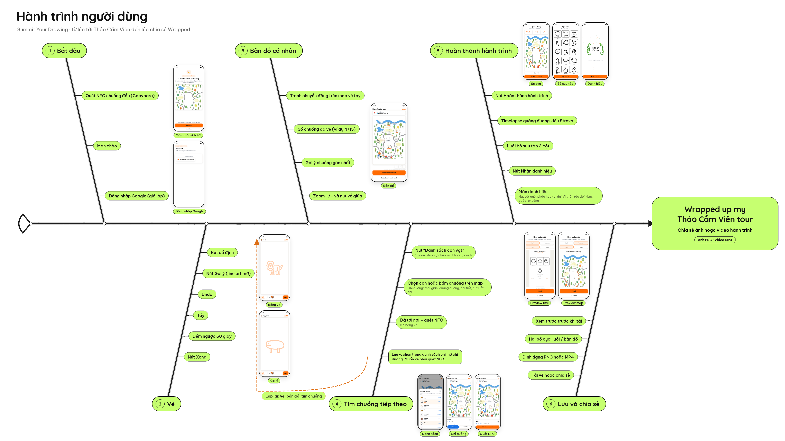
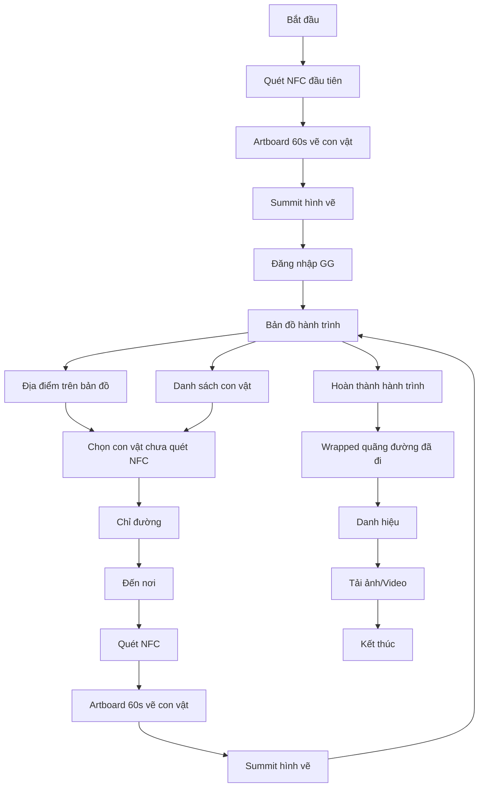

# THU

Làm cho: Thư (Art & Social)

## 2026-11-11
- Đã xong: Ý tưởng B2C tại Thảo Cầm Viên, pitching ngày 10/11/2026 — overview, vấn đề của Thảo Cầm Viên, idea Summit Your Drawing (tổng quan, flow, art direction) và bản demo web v4. Nội dung nằm ở các mục bên dưới; demo ở [THU/demo/](THU/demo/).
- Đang làm: sẽ bổ sung sau
- Kế tiếp: sẽ bổ sung sau
- Vướng / rủi ro: Bản icon có trả phí, chỉ dùng làm demo.
- Cần anh BeeNgyy quyết: sẽ bổ sung sau

## Overview

B2C — sản phẩm dùng miễn phí. Sản phẩm được đặt map tại Thảo Cầm Viên để test tính năng quét NFC → hoàn thành nhiệm vụ → collect điểm/vị trí. Mục tiêu của dự án là có nhiều người dùng để thu thập data, phát hiện ra vấn đề của tính năng quét NFC. Từ đó hoàn thiện và phát triển sản phẩm B2B.

## Problems of Thảo Cầm Viên

- **Lạc đường.** Các biển chỉ dẫn lộn xộn, cảm giác không đi hết được TCV.
- **Bản đồ khó đọc.** Bản đồ không hiển thị địa điểm đang đứng, khó xác định vị trí.
- **Thông tin ở chuồng thú sai.** Chuồng để thông tin con A nhưng trong chuồng là con B; các con vật đi ngủ (không thấy).
- **Tham quan chỉ chụp ảnh.** Mọi người xem TCV như một theme park, đến chụp ảnh check-in các địa điểm hot.

## Idea 1: Summit Your Drawing

Nguồn: file present ngày 10/11/2026, các slide about / tính năng / user flow / art direction của idea 1.

### Tổng quan

Quét NFC ở mỗi chuồng thú, người dùng có 1 phút vẽ nhanh con vật trong chuồng, sau đó hình vẽ con thú sẽ được làm chuyển động và được collect vào map sở thú. Người dùng tiếp tục tới các chuồng khác theo chỉ dẫn của bản đồ, quét NFC để vẽ con vật. Kết thúc hành trình người dùng sẽ có bản wrapped hành trình đã đi qua, các con vật đã vẽ.

**Vẽ con vật**
- 60s để vẽ con vật
- Gợi ý nét vẽ
- Cố định size và màu brush

**Map chỉ đường**
- Hiển thị hình ảnh đã vẽ chuyển động trong chuồng thú
- Chỉ đường
- Các chuồng đã vẽ và chưa vẽ

**Wrapped**
- Hiển thị quãng đường người dùng đã đi qua
- Danh hiệu
- Tải về các hình đã vẽ, video quãng đường đã đi

### Flow

Thứ tự các bước trên slide user flow:

1. Bắt đầu
2. Quét NFC đầu tiên → Artboard 60s vẽ con vật → Summit hình vẽ → Đăng nhập GG → Bản đồ hành trình
3. Từ bản đồ hành trình, người dùng có thể xem địa điểm trên bản đồ hoặc danh sách con vật, chọn con vật (chưa quét NFC), nhận chỉ đường, đến nơi, rồi quét NFC và lặp lại vòng vẽ (Artboard 60s → Summit hình vẽ → quay lại bản đồ)
4. Khi hoàn thành hành trình: Wrapped quãng đường đã đi → Danh hiệu → Tải ảnh/Video → Kết thúc

Ảnh user flow (bản fishbone v4 của demo, không phải screenshot slide Figma):

### Art direction

Nhãn trên slide 8: **IDEA 1: SUMMIT YOUR DRAWING**; thanh mục **ABOUT/ USER FLOW/ ART DIRECTION/ DEMO** (đang đứng ở Art direction); tiêu đề hai cột **MOODBOARD** và **UI DESIGN**; ba nhãn style **Miniature doodle**, **Kiddy**, **Loose Sketch**.

#### Mô tả moodboard

Cột Moodboard gồm ba hướng tham chiếu, xếp thành cụm bên trái trên nền trắng, nhiều khoảng trống.

- **Miniature doodle.** Chữ vẽ tay nhiều màu, nét không đều, kiểu poster: dòng “LONG TABLE POP-UP”, mỗi chữ một màu (xanh ngọc, đỏ, cam, xanh dương, hồng, tím). Bên dưới là một cái bàn vẽ rất giản, nét mảnh màu xanh ngọc. Cảm giác handmade, vui, hơi lễ hội.
- **Kiddy.** Bản đồ minh họa nhìn từ trên xuống, kiểu bản đồ công viên cho trẻ em: cây và bụi là chấm hoặc bệt xanh, sông uốn màu xanh dương, lối đi vàng-nâu, thú và người vẽ nhỏ xíu, nét ngây. Màu pastel, không theo kiểu sơ đồ kỹ thuật, gần với truyện tranh thiếu nhi.
- **Loose Sketch.** Chỉ mực đen trên nền trắng: đàn thú (cừu, chim, sư tử, hươu cao cổ và vài con bốn chân khác) vẽ nhanh, nét run và hơi nguệch, có chỗ vòng xoắn gợi lông. Không tô màu, không viền sạch, giống phác trong sổ.

Cột **UI DESIGN** (cùng slide): ba mockup điện thoại trên nền xanh mint nhạt, cạnh một bảng ô màu bo góc. Giao diện tham chiếu dùng hình tròn, góc mềm, nhân vật hoạt hình mặt to, mũ xanh, áo vàng; màu kem, cam, mint và xanh lá. Chữ đọc được trên mockup gồm “Find your peace”, “Have a nice day”, “Sport Mood”, “Playlist”, “Sign up”, “Log in”; góc có mác 1/6. Đây là UI tham chiếu, không phải màn hình demo Summit.

Cảm giác chung của hướng art: vui, trẻ, vẽ tay, gần sổ phác và đồ họa thiếu nhi. Bản thân slide thì sạch: tiêu đề cột chữ lớn, nét mảnh, đen trên trắng; thanh đầu màu xanh chuối.

Slide không in mã màu. Trên cột UI design có một bảng ô màu; mã hex dưới đây lấy xấp xỉ từ ảnh chụp slide (không phải số in trên deck), và bảng này nằm cạnh các mockup UI tham chiếu nên chưa rõ có phải palette chính thức của Summit hay chỉ là ảnh moodboard:

- Vàng `#FEDA3B`
- Xanh lá `#25B752`
- Đỏ `#FF3131`
- Xanh dương `#7DB2F6`
- Hồng `#FF93A2`
- Cam `#FF5800`
- Nền kem của bảng `#FFF8EE`

Ảnh gốc trên moodboard không đưa vào repo.

## Demo v4

Bản demo web tĩnh nằm ở [`THU/demo/`](THU/demo/). Mở [`THU/demo/index.html`](THU/demo/index.html) bằng Chrome hoặc Edge (kéo thả vào trình duyệt hoặc mở `file://`).

Trong demo, nút **Gợi ý** hiện hình nét cam mờ trên bàn vẽ. Bộ icon gợi ý gồm 15 con; theo README trong thư mục demo:

- 11 icon cắt từ bộ stock trả phí Colourbox #46749229 (“wild animals outline vector icons safari and jungle concept”): `sutu`, `huou`, `voi`, `tegiac`, `gau`, `ho`, `honghac`, `casau`, `hama`, `ngua`, `dadieu`.
- 4 icon do Hai tự vẽ, dùng tự do: `vuon`, `capybara`, `cong`, `meerkat`.
